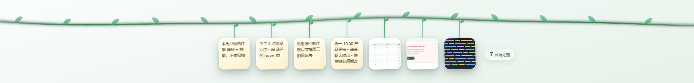

# 藤蔓 · Vine（Demo）

屏幕顶部一条藤，今天要用到的截图和便签都挂在上面。用完就摘下来。



## 运行

双击 `start.bat`（首次需要先 `npm install`），或在本目录执行 `npm start`。

桌面上已生成快捷方式「藤蔓」，双击即可启动；如果已经在运行，双击会直接把藤条重新显示到最前面（不会开第二个实例）。

首次启动会自动放 7 个示例节点（4 张便签 + 3 张截图）。想恢复示例：托盘图标右键 →「恢复示例节点（重置藤条）」，会把当前藤条清空并重新放回这 7 个示例（也可以删掉 `%APPDATA%\vine-demo\vine-state.json` 再启动）。

## 交互

| 操作 | 效果 |
| --- | --- |
| 鼠标悬停节点 | 微微放大，下方浮出全文 / 大图预览 |
| 按住节点左右拖 | 调整顺序（最新在最左） |
| 按住节点往下拖超过约 120px | 摘下来，变成一张置顶浮窗 |
| 浮窗标题栏拖动 | 移动位置 |
| 浮窗右下角拖动 | 缩放大小 |
| 浮窗里 `↑ 挂回` | 放回藤上原位置 |
| 浮窗里 `×` 或 `Esc` | 当作"用完了" → 关闭，待处理数 -1，藤上留一个虚线摘痕 |

浮窗头部还有「100%」循环调透明度、「复制」把便签文字或截图放进剪贴板。

## 快捷键

- `Ctrl+Shift+A` 截图（拖拽框选区域，`Esc` 取消）
- `Ctrl+Shift+N` 写便签
- `Ctrl+Shift+Q` 显示 / 隐藏藤条
- `Esc` 取消截图、关闭浮窗
- 浮窗里 `Alt+↑` 挂回

托盘图标右键还有：显示/隐藏、截一张图、写个便签、全部完成（收藤）、恢复示例节点、退出。

## 数据

- 节点：`%APPDATA%\vine-demo\vine-state.json`
- 截图原图：`%APPDATA%\vine-demo\shots\`

## 常见问题

### 屏幕右侧出现一块纯黑

不是藤蔓窗口画的。实测结论：Codex 桌面端自己会留一个「整屏高、半屏宽」的透明浮层窗口，偶尔它卡在桌面最上层又渲染不出来，就变成一块黑。黑块边界和那个残留窗口完全重合；把残留窗口隐藏后，屏幕立即恢复正常。

处理方式：

1. 退出并重开 Codex（最彻底）
2. 或者双击上一层目录的 `fix-black.bat`，它会隐藏这类残留浮层窗口

同时藤蔓窗口的置顶层级已从最激进的 `screen-saver` 降到 `floating`，减少和其他置顶窗口抢合成层的概率。

## 这个 demo 还没做

- 节点太多时只做了自动缩小，还没有左右翻页
- 没有跨日自动收藤
- 快捷键还不能自定义
- 没有打包安装程序，目前是 `start.bat` 直接跑 Electron

## 目录

```
main.js              主进程：窗口、托盘、快捷键、截图、数据
preload.js           IPC 桥
renderer/vine.*      藤条 + 节点 + 便签输入框
renderer/card.html   摘下来的浮窗
renderer/capture.*   框选截图
assets/              图标与示例素材
previews/            预览图
```

## 提交约定

每次提交都要把「改了什么、为什么改」写清楚，便于回溯：

1. 首行一句话概括（`feat:` / `fix:` / `docs:` / `refactor:` 开头）
2. 空一行，正文分条列出具体改动和涉及的文件
3. 有行为变化或兼容性影响的，单独说明

不提交的内容：`node_modules/`、`待办.txt`、运行产物和日志，见 `.gitignore`。